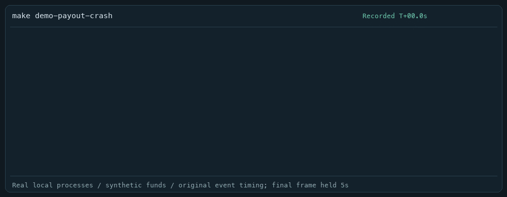

# LedgerOps

A payment ledger that keeps money reserved when a worker dies after the provider
has already paid. A read-only operator assistant explains the rules and gathers
caller-authorized evidence; people review and submit proposed actions.



## See the hard failure happen

With Docker, Python 3.12 and [uv](https://docs.astral.sh/uv/) installed:

```sh
make demo-payout-crash
# Include the assistant API restart and draft-resume acceptance:
make verify-release
```

The demo creates disposable services, submits a payout, waits for the provider's
durable payment, kills the worker, and restarts it. Recovery uses the same provider
key and LOOKUP. The final screen checks one provider payment, one ledger settlement,
one outgoing journal and a healthy independent verifier, including a replayed admission request and a further worker scan.
It removes only its own test resources. See the [recovery walkthrough](articles/provider-paid-worker-died.md).

For purchase, reversal and projection-drift examples, run `make demo`.

## Try the operator assistant

```sh
python3 assistant/scripts/compose.py up
```

Open <http://127.0.0.1:8088> and choose **Try synthetic demo**. The panel streams
progress, shows source citations and uncertainty, and pauses a draft for human
review. The local demo uses fake answer generation and a real pinned embedding
model. It downloads public model weights on first start; no model API key is needed.
Stop it with `python3 assistant/scripts/compose.py down`.

The [assistant guide](assistant/README.md) covers caller tokens, providers, MCP and
the API. Its tools use the caller's identity and fixed read-only endpoints. The
assistant never submits a payout, releases money or approves its own draft.

## How it works

1. Admission reserves funds and stores a business-stable provider key.
2. A worker claims the payout and commits `MAY_HAVE_SENT` **before** network I/O.
3. The provider may commit even if the worker never receives its response.
4. After the claim lease expires, recovery asks the provider what happened with
   `LOOKUP`, using the same key. It keeps the hold while the outcome is uncertain.
5. An authoritative observation resolves the hold and journal in one database
   transaction. Repeated observations do not settle the payout again.

The [payout guide](docs/PAYOUTS.md) shows the states and recovery rules. PostgreSQL
constraints, stable keys and independent verification each enforce part of the
contract; an application retry loop alone cannot provide it. The provider must
support the documented idempotency, lookup and closure semantics.

For documentation questions, the assistant combines PostgreSQL full-text search
and pgvector, fuses ranks with RRF, and provides bounded source context to a model.
References are checked against the supplied passages. LangGraph persists draft
review checkpoints in PostgreSQL and rechecks identity and evidence on resume.
These checks constrain behavior; citations alone do not prove an answer is correct.

## Read and verify

Start with the [six operating guides](docs/README.md). Detailed protocols, database
invariants, deployment recipes and decisions live in [internals](docs/internals/README.md).

```sh
make bootstrap
make check
make test
```

Tests use disposable PostgreSQL/provider services, real process crashes, exact
financial expectations and independent invariant checks. The assistant has its own
fake-model tests, authentication and recovery tests, and a real-embedding development
retrieval gate. Current-corpus results and limitations are in the
[retrieval report](assistant/docs/RETRIEVAL-QUALITY-V2.md) and
[performance report](assistant/docs/PERFORMANCE.md).

The project homepage is excluded from the versioned assistant corpus. Changing
this introduction therefore cannot invalidate retrieval evidence. Operating-source
changes still require reviewed labels and a new baseline.

## Scope

This is a learning and engineering reference, not a production payment service.
Its guarantees are tested against the included provider protocol and PostgreSQL
model. Local Docker runs do not establish cloud availability, arbitrary-provider
compatibility or injection immunity. Cloud deployment remains preparation-only;
no live-cloud cost or deployment claim is made.
