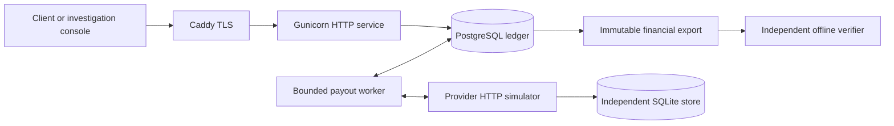

# LedgerOps

**A PostgreSQL ledger for concurrent spending, uncertain payouts and auditable recovery.**

LedgerOps follows a payment from admission to reconciliation and recovery. It asks
what happens when two requests compete for the same money, a provider commits just
before a worker dies, or a balanced journal credits the wrong merchant.

The service uses **Python 3.12, explicit SQL transactions and PostgreSQL 18**. An
independent, persistent SQLite payment-provider simulator makes external failures
reproducible. All payment execution is synthetic.

[中文项目导览](docs/PROJECT-TOUR.zh-CN.md) ·
[Run the service](docs/RELEASE-READINESS.md) ·
[Verified failure cases](#failure-cases-you-can-inspect) ·
[Latest verification](evidence/POLISH/2026-11-04/README.md)

## One payment, including the uncertain part

Amounts below are synthetic PLN minor units: `100` means PLN 1.00.

| Step | Customer | Merchant booked / reserved / available | What the result means |
|---|---:|---|---|
| Open accounts | 100 | 0 / 0 / 0 | Synthetic opening fixture |
| Purchase 80 | 20 | 80 / 0 / 80 | Journal, balances and retained result commit together |
| Request payout 60 + fee 2 | 20 | 80 / 62 / 18 | `202` confirms admission; it does not confirm payment |
| Provider outcome unknown | 20 | 80 / 62 / 18 | Hold stays active while evidence is collected |
| Authenticated success | 20 | 18 / 0 / 18 | One local settlement consumes the hold |

An authenticated terminal `FAILED` observation or permanent close-if-absent tombstone releases the hold
without a payout journal. A timeout or `NOT_FOUND` response does not.

The provider key and exact request bytes survive retries and process restarts.
Before the immutable dispatch deadline, retries use that identity; after it,
recovery requests closure under the simulator's specific contract. Provider success
followed by a local crash is recovered through retained evidence, without creating
a new payment identity.

## Architecture



- **Admission:** current scoped authorization, request/business identity claims,
  UUID-ordered balance locks, and journal/projection/result writes in one transaction.
- **Payouts:** a hold and durable dispatch intent precede network I/O. The worker
  commits `MAY_HAVE_SENT` before calling the provider, then records observations in
  a separate transaction.
- **Independent checks:** A recomputes balances from entries; B compares effects
  with retained original requests. The verifier does not call posting helpers.
- **Operations:** versioned reconciliation pins source bytes. A separate operator
  instance supports typed maker/checker reprocessing bound to current evidence,
  permissions, target versions, expiry and restore generation.

The loopback teaching lab is a separate disposable tool outside the production
package. It is not the authenticated service or its operator console.

## Try it locally

Requires Python 3.12, [uv](https://docs.astral.sh/uv/), `make` and Docker.
Run from the repository root:

```sh
make bootstrap
make demo
```

The narrated demo creates temporary PostgreSQL, executes purchase/refusal/reversal,
injects balance drift, detects it offline, then freezes, rebuilds and resumes. Each
step asserts the result before printing it. Its database and exports are cleaned
on exit; Docker absence fails explicitly.

To inspect real SQL and observed lock waits interactively:

```sh
make lab
```

Open the loopback URL printed in the terminal. Use the page's end action or Ctrl-C
to clean up. The [linear Chinese tutorial](docs/learning/LEDGEROPS-TUTORIAL.zh-CN.md)
explains the R1/R2 core without requiring browser interaction.

For the **authenticated HTTP service, payouts, TLS and native restore**, follow the
[Linux runbook](ops/linux/README.md). It builds from a clean Git commit, installs the
wheel, provisions separate roles/secrets and runs without a host source mount.
Default startup keeps financial writes and dispatch disabled until explicit
activation. The demo above covers the ledger/maintenance story, not every subsystem.

## Failure cases you can inspect

These tests use real PostgreSQL, processes or protocol boundaries where stated.
They provide concrete entry points for reviewing the design.

| Scenario | Expected behavior | Executable evidence |
|---|---|---|
| Two purchases of 80 compete for 100 | One commits; the other retains a 422 refusal | [Concurrent purchase](tests/integration/test_purchase_concurrency.py) |
| Provider commits, then worker receives SIGKILL | Recovery retains the original identity and one external effect | [Worker crash/restart](tests/integration/test_payout_worker_process.py) |
| A balanced transfer credits the wrong merchant | A can pass; independent B detects the wrong owner and blocks rebuild | [Business-intent verification](tests/integration/test_export_verification.py) |
| Different merchants compete for clearing capacity | Admission serializes on clearing and includes all active holds, including UNKNOWN | [Clearing commitments](tests/integration/test_payout_clearing_commitments.py) |
| Workspace A has 21 blocked payouts; B has one normal payout | B is dispatched in the first batch of 20 | [Queue fairness](tests/integration/test_payout_queue_fairness.py) |
| An approval outlives its evidence or permissions | Execution rechecks current facts; the proposer cannot self-approve using another credential | [Operator actions](tests/integration/test_operator_actions.py) |
| Provider is ahead of a restored database | HISTORY/LOOKUP recovery keeps runtime CONNECT closed and revokes old credentials; missing admission is an explicit gap | [Native backup/recovery](tests/integration/test_backup_recovery.py) |

The [Chinese walkthrough](docs/PROJECT-TOUR.zh-CN.md) names the specific test
functions and explains the transaction boundaries behind these cases.

## Design choices worth reviewing

**Explicit transactions over hidden business workflows.** Python coordinates the
business decisions; SQL makes identity claims and lock order visible. Database
constraints protect declared structure, append-only journals and nonnegative
projections. They cannot prove that an otherwise balanced payment belongs to the
right merchant, which is why independent A/B checking is part of the design.

**Unknown outcomes retain obligations.** A transport failure cannot release a hold
or establish that no payment occurred. This costs availability while an outcome is
unresolved, but avoids spending money already committed to an external payment.

**Rebuild from facts, not a saved preview.** After writer drain, repair recomputes
journal and active-hold projections under an exclusive barrier. Fresh SQL targets,
an independent after-check, repair audit and epoch update commit together. Legal
active holds are supported; original history remains unchanged.

**Bounded evidence rather than truncated evidence.** Large financial sources use
chunked format10 and a disk-backed SQLite index for complete verification. Missing
chunks, unsupported semantics or exhausted budgets fail explicitly. A compact R4
matching view retains pins to the full source and is rechecked before an action.

The active-hold query has a partial covering index. A documented sample with
50,000 terminal rows and eight HELD rows changed shared-block accesses from 667 to
2, with the same sum and the default planner. This is a [specific query-plan
measurement](docs/ACTIVE-HOLD-INDEX.md), not a throughput benchmark.

## Verification snapshot

**2026-11-04:** 1,721 tests passed, with zero failures or skips in the final full
run. Nine Linux acceptance groups also passed from a clean installed-wheel image.
The record includes actual disk exhaustion, large-source maintenance, TLS,
restricted runtime roles, process restart and native `pg_dump`/`pg_restore`.

```sh
make check     # lint, format, fresh installed package and SQL resources
make test      # full suite, including disposable PostgreSQL and provider processes
make build    # wheel and source distribution
```

See [commands, source commits, image IDs and results](evidence/POLISH/2026-11-04/README.md).
The record retains earlier failures and their corrections. These are dated local
verification results, not a GitHub CI badge or proof of every failure schedule.

## Scope and further reading

This is a single-host, synthetic-provider system with a tested local Linux deployment.
The simulator's persistent keys, finality and close-if-absent tombstones are explicit
protocol assumptions. A real provider needs its own adapter and contract. Real-bank
execution, cloud/HA operation and browser visual interaction have not been validated.

| Read next | Purpose |
|---|---|
| [Running guide](docs/RELEASE-READINESS.md) / [Linux runbook](ops/linux/README.md) | Setup, safe defaults, upgrades, diagnostics and cleanup |
| [Authentication](docs/AUTHENTICATION.md) / [HTTP service](docs/HTTP-SERVICE.md) | Current permissions and service boundaries |
| [Payout contract](docs/tasks/R3.md) / [Reconciliation](docs/R4-ACCEPTANCE.md) | Provider uncertainty and immutable settlement evidence |
| [Maintenance](docs/MAINTENANCE.md) / [Backup and restore](docs/BACKUP-RESTORE.md) | Projection repair and closed recovery |
| [Operator actions](docs/OPERATOR-ACTIONS.md) | Current-evidence maker/checker workflow |
| [Read-only evidence exchange](docs/EVIDENCE-EXCHANGE.md) | Selected immutable evidence and standalone consumer |
| [ADRs](docs/adr/) / [Handoff](HANDOFF.md) | Decisions, revision history and precise implementation status |

Implementation and review were AI-assisted. The repository keeps design decisions,
corrections and reproducible checks visible alongside the code.
