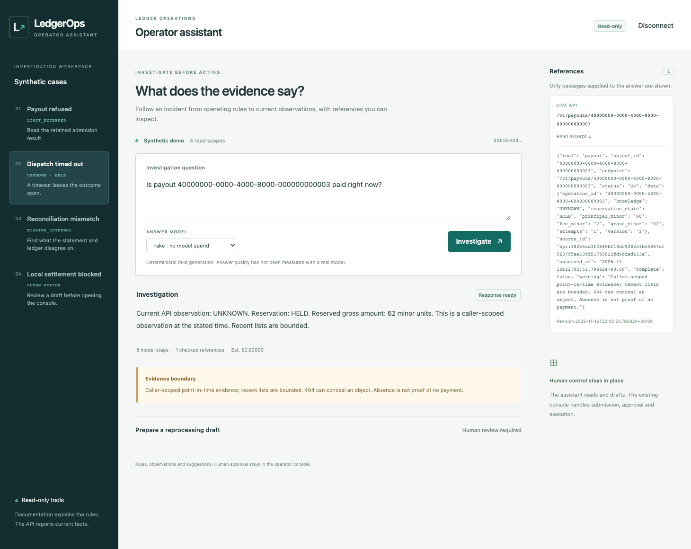

# LedgerOps operator assistant

This is a read-only incident assistant for LedgerOps operators.
It answers from cited operating docs and checks live state through fixed GET tools using the caller's own token.
It can prepare a durable draft for a human to review and submit in the LedgerOps console.



The panel above uses synthetic data and fake generation.

## Current results

| Frozen round 7 | v1.2 reference | Local subscription verifier |
|---|---:|---:|
| Unsupported questions admitted | 77/108 (71.3%) | **1/108 (0.9%)** |
| Documentation questions refused | 2/103 (1.9%) | **4/103 (3.9%)** |
| Hybrid Recall@5 | 0.9110 | **0.9110** |

Opt into the verifier with `--scope-verifier subscription` on the
[local CLI](docs/PROVIDERS.md#local-chatgpt-subscription). It checks the passages
before the answer provider runs. The HTTP service uses the rule evaluated in
round 5, which missed both scope targets. The [evaluation](docs/RETRIEVAL-QUALITY-V2.md)
has every round, confidence intervals and the review of 32 saved answers.

## Try it locally

From the repository root, with Docker running:

```sh
python3 assistant/scripts/compose.py up
```

Open <http://127.0.0.1:8088> and choose **Try synthetic demo**. The panel shows
progress, checked references, uncertainty and estimated cost. Case 04 prepares a
draft for review. The demo has a synthetic GET-only upstream and fake generation;
retrieval uses the pinned local encoder. The first start downloads public weights.
No model API key is required. Generated credentials stay in the ignored
`assistant/.env` file.

```sh
python3 assistant/scripts/compose.py down
```

This stops the dedicated stack and retains its database and model-cache volumes.
See [PRODUCT.md](docs/PRODUCT.md) for HTTP/SSE, MCP and restart verification.

## Access and evidence

The assistant has no financial database connection or approval tool. The upstream
API checks the caller's permissions on each fixed read route. Drafts pause with
LangGraph `interrupt()` and persist in a separate PostgreSQL database; the console
handles submission and approval. Read-only tools enforce the access boundary;
input filters are supplemental.

The operations-v4 corpus contains 20 explicit operational files. The repository
homepage, navigation and article are excluded. Editing an indexed operating rule
requires source-label review and a new development baseline. Historical studies
remain unchanged.

Raw evaluations, generated answers and performance samples are release attachments.
Git keeps questions, protocols, manifests and summaries. See the
[evidence guide](eval/README.md). Citation validation rejects unknown passage IDs
and uncited answers; it establishes provenance rather than semantic correctness.

## Develop

```sh
cd assistant
uv sync --locked
uv run --locked ruff check .
uv run --locked ruff format --check .
uv run --locked python -m pytest
uv run --locked python -m pytest -m postgres
uv run --locked python scripts/evaluate_local.py --split dev \
  --baseline eval/baselines/v1.2-dev.json --output .cache/report.json
npm --prefix web ci
npm --prefix web run build
npm --prefix web test
```

Default tests use fake generation and stand-in embeddings. PostgreSQL tests use
disposable containers. The development gate uses the pinned local encoder and
records experiments in local MLflow. CI does not run the consumed holdouts.

| Guide | Contents |
|---|---|
| [Retrieval quality](docs/RETRIEVAL-QUALITY-V2.md) | Current comparison, frozen protocol, failures and token accounting |
| [Agent and review](docs/AGENT-AND-REVIEW.md) | Caller permissions, bounded tools, durable drafts and console handoff |
| [Local product](docs/PRODUCT.md) | Setup, HTTP/SSE, MCP, telemetry and verification |
| [Providers](docs/PROVIDERS.md) | Fake, API, local model and official subscription adapter |
| [Evaluation history](docs/HISTORY.md) | Earlier corpus snapshots and their limitations |
