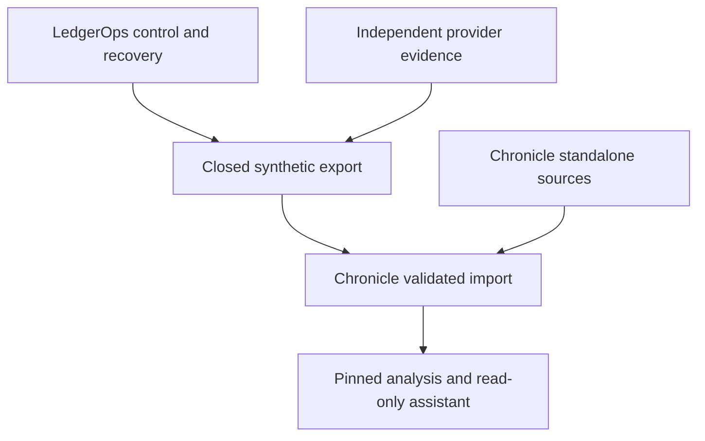

# Cross-project boundaries, interoperability and evidence contract

**Design date:** 2026-10-23. **Status:** proposed engineering contract; neither implementation nor user approval is implied. The two project directions and the authority constraints in the supplied request are accepted inputs. Every stack and schema choice below remains a recommendation until recorded as a decision.

## 1. Ownership and independence

| Concern | Authoritative owner | Other project's permitted use |
|---|---|---|
| Business instructions, journal, balances, holds, external payout recovery | LedgerOps | Chronicle may analyze a completed, versioned synthetic export |
| Operational reconciliation and approval to correct a ledger discrepancy | LedgerOps | Chronicle may explain exported evidence; its answer never authorizes a write |
| Source release history, historical selection, analysis snapshots, derived report versions | Chronicle | LedgerOps does not call these services for safe operation |
| Analytical evidence and AI-generated explanations | Chronicle | Read-only output; no command, callback or approval channel back to LedgerOps |
| Identity, authorization, storage, migrations and backup | Each project separately | Reuse conventions, not credentials, database roles or a shared database schema |

Both repositories must pass their core tests with the other repository absent. Each must have a useful standalone demonstration: LedgerOps runs synthetic instructions/provider evidence; Chronicle runs its own synthetic time-series fixtures and, after source-specific checks, a narrow direct-source historical corpus. There is no shared scheduler, mandatory identity service, agent framework or common package to maintain in the first releases.



The diagram is one-way data transfer. A diagram arrow is not a live production dependency or permission to publish files.

## 2. Transport and trust boundary

Use an explicitly selected directory or archive of UTF-8 JSON and NDJSON files. A network export service is deferred. The consumer is given a completed export, not access to the producer's working directory or PostgreSQL credentials. Before parsing an archive, reject absolute paths, `..`, symbolic links, duplicate member names, unsupported encodings and decompression limits above the configured budget. This is a proposed input contract, not a claim that an archive parser has been implemented.

The manifest lists every permitted member, byte length, SHA-256 and row count. Hash the exact bytes; do not assume different JSON whitespace is identical. An export identifier is an opaque UUID; a content hash identifies particular manifest bytes. JSON examples below use placeholder hashes and identifiers to describe a schema; they are not executable fixtures or measured files.

Local provenance initially means the importer received an explicitly selected synthetic export and verified its byte manifest. A checksum alone is not authentication or proof that its statements are factually true. If transfer crosses a trust boundary later, select authenticated transport or signed manifests with key lifecycle tests before claiming authenticity.

## 3. Envelope version 1

Required manifest fields and types:

| Field | Type and meaning |
|---|---|
| `schema_version` | String `ledgerops-export/1.0`; major rejects incompatible consumers |
| `export_id` | UUID; immutable after publication |
| `producer` | Object: product `ledgerops`, actual application commit, schema migration revision, exporter version; a missing commit is explicitly `unversioned`, never invented |
| `workspace_id` | UUID of the synthetic workspace; not a real customer identifier |
| `synthetic` | Boolean, required `true` in this integration |
| `currency` / `minor_unit_exponent` | `PLN` / integer `2` for v1; another value is rejected until an explicit version supports it |
| `ledger_evidence_set_id` | Identifier for the exact committed ledger/receipt evidence set selected by the export |
| `reconciliation_run_id` | UUID or null; export may exist before a reconciliation run |
| `business_date` / `business_timezone` | ISO date and explicit IANA zone; `Europe/Warsaw` for v1 settlement days, with each day's UTC start/end boundaries calculated explicitly |
| `selection_cutoff_utc` | ISO UTC timestamp used in the export's selection rule; not automatically a complete-source watermark |
| `source_watermarks` | Per-provider/receipt stream evidence of completeness, precision and authority; unknown completeness is represented explicitly |
| `created_at_utc` | Export creation time, distinct from event, settlement and import times |
| `files` | Ordered entries: relative path, media type, byte size, row count, SHA-256, record schema version |
| `rights` | Own synthetic-data declaration and attribution policy; no employer or externally licensed source data |
| `limitations` | Structured flags for unresolved outcomes, missing source ranges and unavailable evidence |

The producer takes a consistent database snapshot of committed local evidence. It copies all selected identifiers into the manifest input set. **`MAX(sequence)` or the largest operation UUID is not a database commit watermark**: gaps and differently ordered commits must not be silently included or excluded. A provider statement has its own independently captured manifest; the export does not claim a cross-database transaction.

At the filesystem boundary the producer writes temporary objects, verifies the bytes, and only then publishes the final manifest. The importer ignores staging files and never follows a mutable `latest` pointer after it has pinned a manifest. Local rename semantics apply only to the tested filesystem; a later object-store deployment needs a corresponding publish protocol.

## 4. Record identity, units and time

Each record contains `record_type`, `record_id`, `workspace_id`, `source_record_id` when one exists, `schema_version` and `provenance`. Record identity is namespaced by producer, workspace and record type. A `record_id` never changes meaning. A correction adds a new revision with `supersedes_record_id`; it does not overwrite an exported row.

**Money:** `amount_minor` is a decimal string containing an integer, not a floating-point JSON number. Posting direction is a separate `debit`/`credit` enum and amounts are positive. The exporter maps LedgerOps's internal `D` to `debit` and `C` to `credit`; the importer accepts only the exported enum. Currency and scale must agree with the manifest. A report may render 100 minor units as PLN 1.00, but must not reinterpret 100 as PLN 100.00. Ledger account normal balance convention comes from the LedgerOps contract; Chronicle must not infer it from the sign.

**References:** `operation_id` is the stable business-operation identity, `request_key` is transport idempotency identity, `attempt_id` is one attempted delivery, and `provider_execution_id` is provider-assigned. These fields are not interchangeable. Omit request keys from public demo exports if they add no explanatory value; always retain operation and external evidence identity.

**Three time dimensions, where available:**

1. `effective_at` or `effective_period`: when the business event or measured period applies.
2. `source_available_at`, `source_sequence`, `availability_precision`, `availability_evidence_id`: when and in what order that source exposed this fact. Null means unknown; a provider statement date alone does not justify a precise timestamp.
3. `producer_received_at` and `producer_evidence_set_id`: when LedgerOps received/captured it. Chronicle adds its own real `imported_at`, ingestion batch ID and committed snapshot membership. It never copies a producer time into Chronicle's actual local ingestion time.

All precise timestamps are UTC with an explicit offset in serialized input. Day-level evidence is a `date` plus named source timezone and `availability_precision="date"`, matching Chronicle's enum; it is not invented midnight certainty. The other accepted precision values are `instant` and `unknown`. Missing or contradictory timing becomes an explicit missing/ambiguous result for the relevant cutoff query.

`business_receipt`, `journal_entry`, `provider_execution` and `provider_statement_line` are distinct record types. An internal purchase may have no provider statement line. Grouped settlement needs explicit group/member references and a versioned fee rule. Matching by similar amount alone cannot establish that two records describe the same obligation.

## 5. Import transaction and failure contract

Proposed importer sequence:

```text
receive manifest bytes and selected export directory
validate version, member allowlist, limits, hashes, rights and synthetic=true
parse each row with strict types; reject duplicate identities with unequal content
write raw bytes durably to Chronicle's immutable object area
stage normalized records under a new ingestion_batch_id
validate references, units, explicit missing evidence and row counts
in one metadata transaction:
    insert immutable snapshot membership for validated batch set
    record manifest content hash and independent producer provenance
    publish snapshot by compare-and-swap against expected current pointer
commit; only then expose new snapshot to readers
```

An identical manifest re-import is a no-op returning the existing batch/snapshot reference. Same `export_id` with different bytes is `EXPORT_ID_CONFLICT`, quarantined. An unsupported major version is `UNSUPPORTED_SCHEMA`; missing bytes are `INCOMPLETE_EXPORT`; a hash mismatch is `CORRUPT_EXPORT`. None of these errors publishes a partial report. An older, complete export can be imported after a newer one without changing what was known in an already published Chronicle snapshot.

Import success means the supplied manifest was ingested according to its contract. It does not establish that LedgerOps is correct, that the provider told the truth, or that its statement coverage is complete. The independent reconciliation fixtures remain necessary.

## 6. Schema evolution and compatibility tests

Major changes include identity reinterpretation, monetary scale change, altered debit/credit convention, changed timestamp meaning, and turning missing evidence into a fabricated default. Such changes require a new major version and an explicit migration adapter producing new immutable output. Preserve original bytes.

Minor additions may introduce optional fields with defined defaults only if old consumers can safely ignore them. A new enum value that changes financial or temporal meaning is not automatically backward compatible. Reject unknown record types in strict v1; a future capability negotiation can change that behavior.

Required integration tests, all **future tests**:

| ID | Input or fault | Required outcome |
|---|---|---|
| X-01 | LedgerOps export imported into Chronicle; both then run separately | No network call or shared database write is needed for either core workflow |
| X-02 | Same bytes imported twice | One batch identity; no duplicated report inputs |
| X-03 | Same export ID, altered merchant or byte | Conflict/quarantine; previously published snapshot unchanged |
| X-04 | PLN minor-unit amount `100`, exponent 2 | Render PLN 1.00; exact integer arithmetic remains 100 |
| X-05 | A later-received provider revision refers to an earlier effective day | Historical source query and actual local snapshot query remain distinct |
| X-06 | Internal purchase with no provider settlement | Valid internal record; no fabricated missing-payment discrepancy |
| X-07 | Unsupported major / missing member / archive traversal | Deterministic rejection before publication; no file escapes staging root |
| X-08 | Import crashes after file persistence, before metadata commit | No published half-snapshot; orphan identified for delayed GC |
| X-09 | Snapshot references a missing object after restore | Evidence unavailable; no silent fallback to the newest data |
| X-10 | AI response recommends fixing a ledger record | It remains text with evidence/limitations; no write tool or shared credential exists |

These tests supplement each project's own invariants; they do not require integration before either project's first release.

## 7. Shared evidence format without a shared framework

Use the same directory conventions in both repositories, implemented locally:

```text
evidence/<release-id>/<run-id>/
  manifest.json
  environment.json
  assertions.json
  input-manifest.json
  process-history.ndjson
  failures/                 # if any, not required to be empty
  benchmark.json            # only after an actual experiment
```

`manifest.json` records actual application revision/dirty state, requirement and test IDs, UTC start/end, input/seed identities, test harness version and result status. `environment.json` records OS/architecture, CPU, memory, container limits, PostgreSQL and client versions, storage/filesystem, process count and relevant durability settings. Record whether cold/warm cache, fault injection and resource saturation were involved. A seed identifies generated inputs, **not** a guaranteed replay of real OS/PostgreSQL scheduling. Save explicit interleaving barriers/failpoints and observed histories.

Each release has three independent fields:

| Field | Valid values | Evidence required |
|---|---|---|
| `implementation` | absent / partial / present | Actual revision and changed module list |
| `verification` | not_run / failed / passed_with_scope | Test IDs, environment and actual results; never inferred from source inspection |
| `personal_ownership` | not_assessed / explained / modified / debugged / transferred | Specific review or exercise record if voluntarily provided; unknown stays unknown |

An AI-assisted implementation may be documented as implemented and tested while ownership is unassessed. No personal-learning flag controls whether AI may implement a later release. Conversely, the existence of code or a large test suite does not upgrade personal ownership. This is a status format for release evidence, not a new daily tracker.

## 8. Common runtime and operational assumptions

Recommended shared language/runtime family: Python 3.13, PostgreSQL 18, explicit psycopg 3 transactions, strict Pydantic request parsing, pytest and property tests; narrow React/TypeScript interfaces after useful backend workflows. The [reference register](01-REFERENCE-REGISTER.md#u-01) contains inspected candidate versions and license evidence. Those source observations are not a tested dependency lock. The first implementation PR must select supported patched builds, resolve exact wheels/transitive dependencies, pin image digests and record compatibility results. Do not install a moving `latest` in a reproducibility claim.

For local capacity planning, offer a small profile that runs one database and one application at a time on the user's available machine; a fuller fault/benchmark profile may use multiple processes and more disk. A suggested 4 logical CPU / 8 GB RAM baseline is a planning assumption, not known hardware or a proven minimum. Report actual resource use. Synthetic fixtures need no API key, GPU, paid model, bank account or cloud account. Hosted deployment and real-model evaluation are separately authorized later; no cost or throughput has been measured here.

LedgerOps database files and Chronicle object files have separate backup semantics. A restored database does not roll back the provider or re-create missing objects. Each restore runbook must prove its own evidence closure before normal operation resumes.

## 9. Decision ownership

Both project directions, synthetic-money scope, independent operation, no unapproved external action and unrestricted AI lead are supplied constraints. PostgreSQL versions, concurrency mechanism, filesystem publication protocol, exact model choice, retention budgets and build order remain proposed choices. The release decision tables explain recommendations, alternatives, reversal cost and discriminating experiments. Approval may be delegated explicitly, but must never be fabricated.

The architectural review can proceed from either [LedgerOps handoff](ledgerops/HANDOFF.md) or [Chronicle handoff](chronicle/HANDOFF.md). The integration export is optional work after the standalone contracts are verified; it is not a prerequisite to either project.
