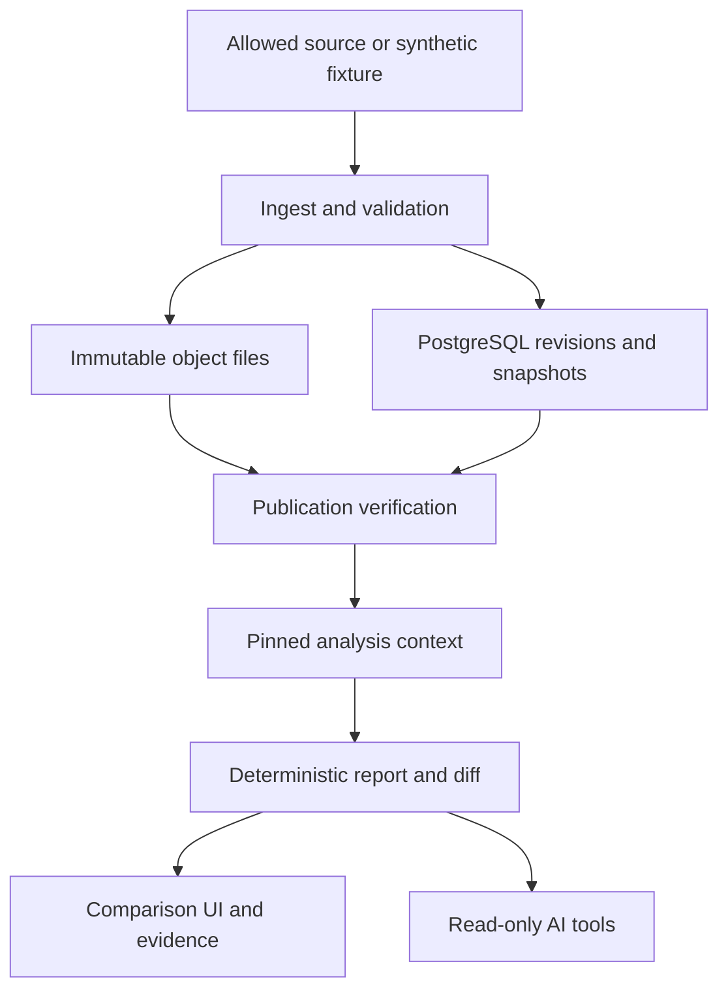

# Chronicle — implementation blueprint

Status: proposed design, 2026-10-23. No implementation repository, passing test run, benchmark, deployment or adoption exists. User-selected project direction and boundaries are accepted; implementation choices below require review. AI may implement several releases ahead of personal learning.

## 1. Product and owned contribution

An analyst opens a monthly employment/industrial-production report, selects a historical information cutoff, inspects the versions supporting each result, and asks why a newer report differs. A software/ML engineer can reproduce the deterministic bundle and check whether a revision invalidated a derived result. This is a designed workflow, not evidence of market demand or real client delivery.

The owned engineering contribution is a small, explicit contract spanning **source evidence, temporal selection, atomic snapshot publication, revision-aware calculation and verifiable explanation**. It is not a new database kernel, a complete feature store, an unrestricted research agent, or a claim that temporal tooling does not exist.

The product is useful without AI: compare two versioned report tables, open each contributing observation/revision, inspect missing-data reasons, and download an allowed reproducibility bundle. AI later helps a user navigate this same evidence through bounded tools. Numbers and difference attribution come from deterministic code.

### Concrete first report

- Monthly employment change in thousands: `employment[m] - employment[m-1]`.
- Trailing three-calendar-month industrial-production mean: `(production[m-2] + production[m-1] + production[m])/3`.
- A later optional indicator is production year-over-year percentage change, explicitly requiring `m` and `m-12`; it exercises a longer dependency edge without turning the project into trading research.

Start with synthetic fixtures carrying an unmistakable `synthetic` source namespace. The first real-data adapter is a **narrow four-publication archive**, not all historical US macroeconomic data:

1. BLS Employment Situation, 2024-02-02 and 2024-03-08, Table B-1, seasonally adjusted total nonfarm employment.
2. Federal Reserve Board G.17 releases, 2024-02-15 and 2024-03-15, total-industry summary index values.

Series IDs are `bls.ces.total_nonfarm_sa.archive` and `frb.g17.total_industry_sa.summary`. Their displayed precision and provenance differ from FRED series; do not silently alias them to `PAYEMS` or `INDPRO`. Exact values and rights evidence are in [DATA-RIGHTS-AND-AI-EVAL.md](DATA-RIGHTS-AND-AI-EVAL.md). The source archive corpus is deliberately small enough to review by hand.

**Material correction to the original baseline:** persistent FRED/ALFRED ingestion is not an approved default. Current service/API terms found during this research add caching/database and AI restrictions. Candidate FRED IDs remain a research map, not permission to ingest, redistribute or send data to a model. Use synthetic fixtures immediately; direct-source archives follow their own rights manifest. An unapproved FRED adapter stays disabled. No API key or paid call is needed for the first code slice.

## 2. Recommended architecture

Use **one PostgreSQL 18 database as the authoritative query and metadata engine**, Python 3.13, FastAPI, explicit Psycopg 3 transaction scopes, SQL migrations, pytest/Hypothesis, and a content-addressed local object directory. React/TypeScript is a narrow later client. A worker is a separate process in the same application, initially one active report/ingest executor with bounded job concurrency. Runtime candidate versions and licenses are in the [reference register](../01-REFERENCE-REGISTER.md); exact tested dependencies/images must be locked in the first implementation PR.

PostgreSQL stores normalized revision rows, import batches, immutable snapshot membership, report contexts, deterministic result rows, rights policies and audit events. Files hold raw source bytes, canonical manifests and export bundles. **A PostgreSQL transaction does not atomically write files.** Files are made durable and verified first; one short database transaction publishes references and advances the dataset pointer. Readers always pin a published snapshot/context. The full protocol and crash outcomes are in [CONTRACTS.md](CONTRACTS.md).

### Component ownership

| Component | Owns | Must not own |
|---|---|---|
| Source adapter | Bounded retrieval, source-document identity, original lexical values, release evidence | Invented release timestamps; silent changes to historical records |
| Normalizer | Typed observations, metadata versions, canonical revision identities, quarantine | “Best guess” unit conversions; implicit missing-to-zero conversion |
| Snapshot publisher | Exact accepted batch set and object closure; atomic visibility | Partially published datasets or file-write atomicity claims |
| Query service | Explicit time mode, cutoff checks, stable winner selection | An implicit `now()` that changes halfway through a report |
| Report engine | Named formulas, dependency footprint, result units and rounding | Arbitrary user Python or unrestricted SQL |
| Evidence service | Immutable IDs, provenance, policy-checked excerpts | A mutable webpage treated as immutable historical proof |
| AI adapter | Question clarification and organization of tool evidence | Money movement, data repairs, broad SQL, permission or cutoff overrides |
| UI | Clear time mode, side-by-side results, missing/failure states | Hiding unavailable evidence behind confident prose |

## 3. Why this topology; when to change it

| Alternative | Useful capability | Decision and discriminating experiment |
|---|---|---|
| PostgreSQL only for normalized data/metadata + files for evidence | One query engine; explicit transactions and indexes; less operational state | Recommended through initial reports, incremental logic and AI contract. Benchmark 100k/1m synthetic revisions, skewed histories and concurrent readers before adding an engine. |
| PostgreSQL metadata + DuckDB over immutable Parquet | Local columnar batch scans and memory-bounded analytical execution | Candidate C4 experiment only. Add if a measured query/report workload exceeds its agreed interactive/batch budget after index/query review, and DuckDB improves it enough to justify dual-engine equivalence and file lifecycle tests. No promised speedup. |
| DuckDB as the sole database | Very simple local analytical CLI and files | Attractive if the deliverable becomes one-user offline analysis with serialized writes. Current plan needs multi-request publication, rights, contexts and later UI; benchmark simpler topology before switching rather than assuming concurrency equivalence. |
| XTDB | Mature valid/system-time query model | Valid alternative, not rejected as “too advanced.” Its two dimensions still need explicit source availability, rights, report versions and local evidence. First implement the narrow PostgreSQL model to own these contracts; an XTDB spike may win if interval-history maintenance overwhelms the application. Compare the identical golden corpus and restore workflow. [C-02](../01-REFERENCE-REGISTER.md#c-02) |
| dbt snapshots + DVC/artifact versioning | Observed-row history, DAG transformations and versioned artifacts | Often enough for ordinary warehouse snapshots. A poll cannot recover unobserved intermediate source states; file versioning alone does not enforce availability cutoffs or claim evidence. Use these tools if the requirement narrows accordingly. Chronicle is justified by the combined explicit contract, not by a fabricated absence of alternatives. [C-04](../01-REFERENCE-REGISTER.md#c-04) |
| Dolt/lakeFS or a general lakehouse | Database/data branching, commits or object-version management | Excluded from the initial runtime. A versioned storage engine does not by itself establish source release semantics, rights or correct report code. Any later use requires a scoped comparison and the license checks in the register. |

Do not deploy Kafka, Kubernetes, a feature-store fleet, vector search or an agent framework merely to make the diagram larger. A direct structured tool loop is the AI baseline. Add machinery only for an observed constraint that the simpler design cannot satisfy.

## 4. Time and identity rules

The API exposes three different questions:

1. `latest_corrected`: resolve the current snapshot once, then select its latest accepted source revisions.
2. `source_as_of`: pin an archive snapshot and select only revisions supported as available before an explicit source cutoff. This reconstructs source information from evidence; it does not assert this new application existed then.
3. `system_snapshot`: use a named snapshot actually published by this installation, with no substitution by newly imported historical data.

Observation months are calendar periods `[month_start, next_month_start)`. Day-level publication evidence stays day-level. A cutoff such as “through 2024-02-29” is normalized to the exclusive end date `2024-03-01`; no invented midnight UTC publication timestamp is attached to a source day. An intraday request against date-only evidence returns `UNSUPPORTED_TIME_PRECISION`, with an option to ask a day-level question. Actual ingestion timestamps are UTC instants. Source timezone is retained when a source supplies an evidenced clock time.

Snapshots are identities, not guessed transaction commit times. Store the database publication-record timestamp and an optional separately observed commit acknowledgement. A crash after commit can leave acknowledgement absent while the snapshot is valid. Do not answer exact “what did the system know at 10:03:00?” by comparing a pre-commit `now()` value; use explicit historical snapshot IDs, or report the uncertainty of the available commit-time evidence.

Source revision keys and source sequence ordering are validated. Equal keys with unequal normalized content quarantine the new batch. Same-day different values without authoritative sequence cannot be resolved by ingestion order, UUID, hash or “last writer wins.” Withdrawals are visible events that remove the value; they do not cause an older value to reappear.

## 5. Calculation and explanation

A report context pins snapshot, time mode/cutoff, transformation version, unit/schema policy, parameters and rights-policy version. It can never silently move to a later snapshot. Result rows identify every contributing revision or an explicit missing-data reason.

The first implementation always performs full recomputation. C3 adds precise invalidation for the named formulas, with independent full recomputation as an oracle. A correction at month `m` invalidates employment deltas at `m` and `m+1`, production three-month means at `m`, `m+1`, `m+2`, and production year-over-year values at `m` and `m+12`. Deletion/withdrawal has the same invalidation footprint; output rows become missing rather than retaining obsolete values. A broader unit/schema/code change causes full invalidation unless an explicit versioned dependency rule proves a smaller domain.

Difference reports execute four controlled runs: `(old data, old code)`, `(new data, old code)`, `(old data, new code)`, `(new data, new code)`. Parameters, unit policy and permitted evidence are held fixed. Report data-only, code-only and interaction terms on canonical numeric outputs. Refuse an attribution if either code version cannot consume the other schema or required bytes/code/environment are unavailable. These are controlled software effects, not a causal claim about the economy.

## 6. Security, failure behavior and operations

- Local default: loopback binding, no public deployment, synthetic demo. Once a multi-user UI exists, use separate viewer/operator identities, authenticated sessions and deterministic dataset-scope checks. Do not use an LLM to authorize access.
- Database roles: migration owner is not runtime; ingest/publisher can call approved write procedures; query/report reader has only versioned query surfaces; AI tool service cannot insert revisions or publish snapshots. Direct user/model SQL is out of scope.
- Dataset rights are immutable versioned policy inputs. Derivatives inherit the intersection of source restrictions; neither hashing nor calculation grants export/AI rights. A policy revocation can make an old result inaccessible, which is reported as a rights-limited replay rather than erased provenance.
- Source retrieval uses an explicit hostname/path allowlist, response-size/time limits and no redirects to unapproved hosts. Imported text is data, not instructions. Original credentials and signed URLs must not enter artifacts or logs.
- Invalid data is quarantined with reason and raw-object ID; a bad batch cannot change the current snapshot. An unavailable object, failed hash or incomplete bundle causes a typed failure and health signal, never silent fallback to current data.
- Bound SQL duration, returned rows, request size, import bytes and concurrent jobs. Cancellation reaches PostgreSQL and report processes; a dropped HTTP connection is insufficient. [C-03](../01-REFERENCE-REGISTER.md#c-03)
- Observe import/quarantine counts, publication conflicts, object verification failures, report duration/rows/buffer reads, oldest active pin, cancellation latency, and exact dependency-recompute counts. Log context/job IDs, not source secrets or whole prompts.

### Backup and migration

For the first supported local backup, pause publication and garbage collection; drain or cancel jobs; retain all files referenced by published snapshots/results; make a PostgreSQL backup and a manifest of that referenced object closure; copy/verify objects; only then mark the backup complete. The backup procedure is an explicit operational action, not part of an application transaction. Restore into a clean instance, verify schema compatibility and all referenced hashes before serving contexts. Object files newer than restored metadata are harmless orphans; metadata newer than files blocks affected snapshots. [C-05](../01-REFERENCE-REGISTER.md#c-05)

Migrations use expand/validate/switch stages. Preserve old transformation code and input schemas needed by retained bundles. An application rollback is allowed only while that binary can read the database and bundle schemas; dropping a column or rewriting a retained artifact has no automatic rollback. Never mutate a historical manifest to make new code “work.”

## 7. Delivery boundaries

C1 is an end-to-end synthetic historical-query/report slice. C2 adds real archive adapters and robust snapshot/file lifecycle. C3 adds incremental recomputation and the controlled difference matrix. C4 supplies a useful comparison UI, measured performance and cancellation/restore hardening. C5 adds evaluated read-only AI. Optional C6 adds a rigorously time-correct offline ML experiment only if desired; it is not required for the core flagship.

These are software dependency boundaries, not personal-learning gates or promised dates. Chronicle can begin independently of LedgerOps. Shared standards are copied deliberately; no common database and no generic cross-project framework are required. Later integration is the versioned, read-only contract in [02-CROSS-PROJECT-CONTRACT.md](../02-CROSS-PROJECT-CONTRACT.md).

Local execution needs a machine capable of running PostgreSQL and Python; no specific CPU/RAM, paid cloud, GPU or credit card is assumed. Start with tiny fixtures and report the machine before performance work. Public model inference and deployment require later explicit choices. The design demonstrates temporal/database/analysis engineering if implemented and verified; it does not establish research ML, low-latency C++, real customer delivery or personal mastery by itself.

Read next: [CONTRACTS.md](CONTRACTS.md), [VERIFICATION.md](VERIFICATION.md), [IMPLEMENTATION-AND-DECISIONS.md](IMPLEMENTATION-AND-DECISIONS.md), [HANDOFF.md](HANDOFF.md).
