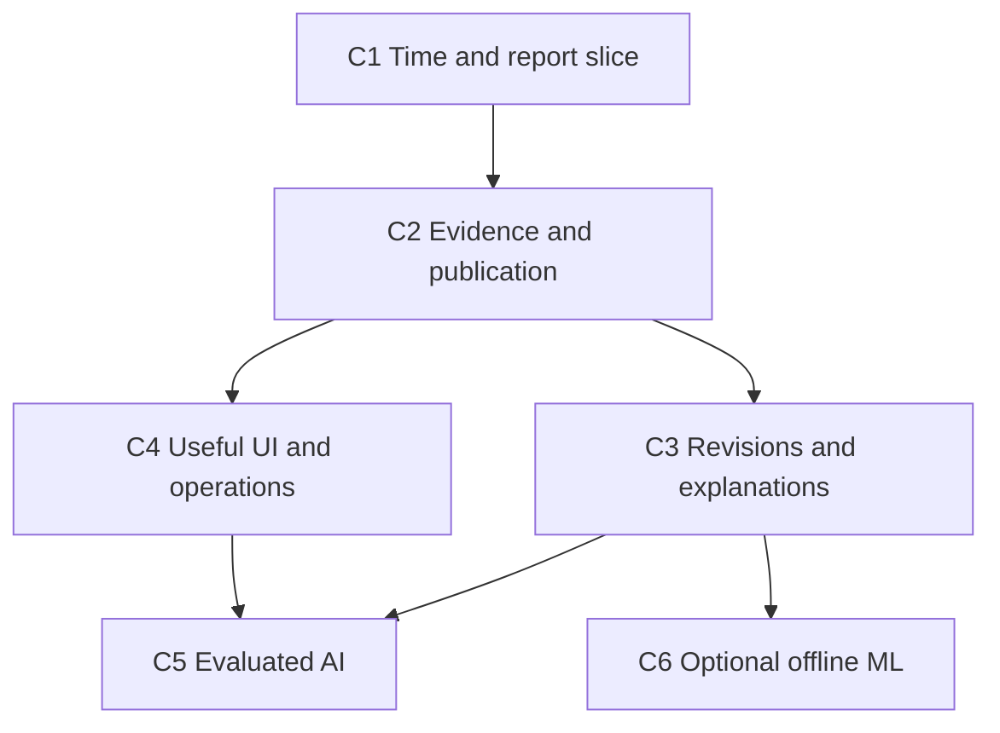

# Chronicle — implementation slices and consequential decisions

Status: proposed work, 2026-10-23. No tasks below have been implemented or approved merely by being written here. The project direction and user constraints are accepted; stack, exact schemas and sequencing are recommendations. There is no personal-learning gate, one-release AI lead cap, completion date or new daily schedule.

## 1. Logical dependencies and parallelism

Chronicle has **no logical dependency on LedgerOps R1 or any other ledger release**. C1 can start from synthetic data while LedgerOps work proceeds independently. Its own release dependencies are:



C4 UI prototyping can begin using frozen contract fixtures before C3 finishes. Model/tool schema work can begin before C5, but answer-quality claims require real evaluated integration. Large-engine performance experiments are optional C4 work, not a prerequisite for the first report.

Recommended human-review policy: allow parallel implementation and research, but present one bounded decision/review packet at a time rather than demanding two large architecture reviews simultaneously. This is a bandwidth recommendation, not an adopted “finish LedgerOps first” rule. AI may continue reversible work under labelled assumptions; externally published data, paid services and destructive changes need the applicable separate authority.

## 2. Proposed module layout

Paths below describe a future repository; they do not currently exist.

```text
pyproject.toml
requirements.lock
compose.yaml
Makefile
src/chronicle/
  api/{contexts,reports,imports,evidence,comparisons,jobs}.py
  domain/{types,time_policy,units,errors}.py
  sources/{synthetic,bls_archive,frb_archive,rights}.py
  ingest/{normalizer,identity,quarantine}.py
  db/{pool,transactions,queries}.py
  snapshots/{manifest,publish,pins,objects,garbage_collection}.py
  analysis/{selection,formulas,dependencies,recompute,bundles,comparison}.py
  workers/{jobs,runner,cancellation}.py
  ai/{tool_contracts,tools,claims,provider,evals}.py
  cli.py
migrations/
tests/
  fixtures/golden/
  reference/{scan_model,rational_metrics}.py
  unit/
  integration/
  faults/
  mutations/
benchmarks/
web/
docs/adr/
evidence/
```

Use explicit SQL with Psycopg transaction scopes; migrations may use the separately reviewed migration tooling without hiding queries behind a full ORM model. The reference model cannot import production selection/formula/invalidation modules. The application does not import test-only fault controls in ordinary deployment. Runtime owners of files and PostgreSQL are separate from ordinary viewer/model identities.

## 3. Release C1 — time contract and one deterministic report

**Deliverable:** a clean-start synthetic demonstration of initial publication, revised past, late ingestion and the three query modes. No network, model or LedgerOps service is required. It produces canonical employment change/production mean rows with explicit version evidence.

| PR slice | Proposed change | Software acceptance |
|---|---|---|
| C1-PR1 | Package/test skeleton; domain types and cutoff validation; frozen tiny fixtures plus independent scan/rational oracle | G1–G4 expected outcomes recorded independently; cutoff precision and natural-key conflicts tested; no production DB claim yet |
| C1-PR2 | PostgreSQL migration for dataset/series/releases/revisions/occurrences/snapshot membership; minimal fixture import and immutable context | C-T01–08 run against real PostgreSQL; staged rows cannot enter a published snapshot query; separate-role write rejection checked |
| C1-PR3 | Fixed report formulas, API/CLI context/report retrieval, canonical output/evidence identity, replay of retained fixture data | `make demo-synthetic` returns the two historical answers and missing states; reference/SQL results agree; concurrent publication cannot change an already created context |

C1 may reference immutable fixture artifacts shipped with the repository and verified on startup. It must not claim the full crash-safe dynamic file-publishing/GC protocol until C2 implements and exercises it. The same manifest schema is used, avoiding a throwaway data contract.

### User decisions before C1

| Decision | Options and recommended default | Trade-off / reversal cost | Smallest useful experiment |
|---|---|---|---|
| C1-D1: What does “as of” promise? | **Recommend explicit source-as-of date, actual snapshot ID and latest-corrected modes.** An implicit combined timestamp is rejected. | More explicit UI/API; high cost to repair mislabeled historical results later. | Predict G1/G2 answers for each mode before inspecting implementation. |
| C1-D2: Primary storage | **Recommend PostgreSQL 18 for normalized data and metadata.** Compare DuckDB-only if product becomes strictly single-user/offline. | PG process setup versus straightforward concurrent context/publication transactions; medium switching cost with exported fixtures. | Run the same tiny query contract and concurrent publication test in a minimal alternative only if this choice is disputed. |
| C1-D3: Numeric/unit contract | **Recommend exact source decimals and decimal12-half-even-v1 derived outputs**, units retained. Alternative floating analytics requires tolerance and replay changes. | Strong deterministic comparisons; excessive apparent precision must be explained; high data-contract reversal cost. | Show why comparing canonical rounded means differs at the final decimal from re-rounding an unrounded difference. |
| C1-D4: First deliverable boundary | **Recommend a complete synthetic report/API/CLI slice**, followed by the narrow real archive. Alternative start with real scraping risks entangling parser/rights and time bugs. | Synthetic alone is not real-data evidence; low switching cost once schema fixed. | Another engineer follows a clean-start command and reproduces two different as-of results with their evidence. |

## 4. Release C2 — direct-source evidence and atomic file/snapshot publication

**Deliverable:** four reviewed direct BLS/Board archives, bounded parsing and rights-aware persistence; complete publication/crash/restore behavior for raw objects and manifests; old source artifacts remain traceable. This establishes the first real-data application, while synthetic operation remains complete.

| PR slice | Proposed change | Software acceptance |
|---|---|---|
| C2-PR1 | Rights manifests and exact four-URL source adapters; archive-table parser with unit/header/column checks | C-T17/C-T21; human-check first extracts and BLS narrative cross-check; no FRED persistence enabled |
| C2-PR2 | Registered staging tickets/objects; durable promotion; publication-request identity; dataset-pointer CAS; reader pins | C-T09/C-T10 fault histories show only complete snapshots; concurrent same-hash writers cannot overwrite/delete each other's object |
| C2-PR3 | Corruption detection, conservative orphan cleanup, explicit no-automatic-published-GC policy, backup/restore CLI | C-T11/C-T12/C-T20; referenced-object closure checked; post-rename paused publisher is not collected |
| C2-PR4 | Parser repair as a new interpretation generation; provenance from retained original payload; defect notices | Old output replays unchanged; repaired output has new dataset generation and is labelled interpretation correction, not source revision |

### User decisions before C2

| Decision | Options and recommended default | Trade-off / reversal cost | Discriminating check |
|---|---|---|---|
| C2-D1: Real corpus and rights | **Recommend direct four-publication BLS/Board tables after scoped rights review.** Synthetic-only remains viable; FRED persistence/AI stays disabled without a compatible basis. | Narrow coverage versus a defensible, inspectable real case; medium adapter cost, low synthetic fallback cost. | Inspect the source notice and exact selected table cells, including adjacent unadjusted columns. |
| C2-D2: Artifact durability boundary | **Recommend service-owned same-volume files plus PostgreSQL publication references.** Alternative store raw bytes inside PostgreSQL for a much smaller corpus. | Files teach cross-resource failure handling; database bytes simplify backup at potentially larger DB cost; medium migration cost if content IDs are stable. | Crash/restore experiment with file missing after metadata publication; if deployment cannot support the filesystem contract, prefer DB bytes or a separately validated object-store protocol. |
| C2-D3: Retention | **Recommend retain all published snapshots/results; collect only closed abandoned staging work.** Automatic expiry is optional later. | Disk growth and explicit cleanup versus clear replay guarantee; high cost once public artifacts are promised. | Calculate storage from measured corpus sizes; exercise paused-writer/collector race before enabling collection. |
| C2-D4: Conflicting imports and parser repair | **Recommend pointer CAS plus explicit rebase, and new interpretation generation for parser fixes.** Avoid silent last-writer-wins and rewriting old rows. | More visible conflict states; preserves audit; high reversal cost after users depend on stable IDs. | Two ready candidates on same base; swapped-column parser repaired without altering old results. |

## 5. Release C3 — incremental recomputation and controlled explanations

**Deliverable:** revision/correction/withdrawal propagation with equality to independent full recomputation; exact old/new data × old/new code comparisons with interaction and incompatibility states.

| PR slice | Proposed change | Software acceptance |
|---|---|---|
| C3-PR1 | Named formula dependency footprints including absent inputs and window halos | C-T14 covers following months, twelve-month denominator, late backfill and withdrawal |
| C3-PR2 | Context-to-context selection diff, bounded invalidation, immutable incremental result builder | Result/evidence equals full oracle across generated traces; code/unit/schema changes trigger justified full rebuild |
| C3-PR3 | Comparison records, four server-owned child contexts/runs, exact decomposition and compatibility checks | C-T16 matrix identity; context mismatch and missing executable return typed incompatible/incomplete result |
| C3-PR4 | Reproducibility bundles with exact retained inputs/code/locks, old-result replay | C-T13/C-T23; unavailable environment is reported, not silently upgraded |

### User decisions before C3

| Decision | Options and recommended default | Trade-off / reversal cost | Discriminating check |
|---|---|---|---|
| C3-D1: Formula scope | **Recommend the two base metrics plus optional year-over-year**, with explicit static footprints. A general user-DAG language is deferred. | Narrower product but fully testable invalidation; medium future extension cost. | Revise a denominator 12 months earlier and see exactly which outputs change. |
| C3-D2: Incremental threshold | **Recommend correctness first and full recompute fallback** for unsupported dependency/code changes. Alternative forced incremental behavior risks stale outputs. | Sometimes more work; low reversal cost after benchmarks. | Compare total incremental overhead against full recompute for one change versus widespread revisions. |
| C3-D3: Missing and unknown availability | **Recommend fail closed for an authoritative historical value when a higher-order unknown-time revision could change it**, with older evidence shown only as incomplete. Alternative best-effort value must be separately labelled and excluded from strict evaluation. | More abstentions versus justified knowledge claims; high semantic reversal cost. | Give a known 100 and later unknown-time 103; decide what can actually be asserted about an intermediate cutoff. |
| C3-D4: Explanation contract | **Recommend a four-run matrix and explicit interaction**, with context/units/parameters held fixed. Plain two-result comparison remains a different operation. | More retained runs and more honest incomplete cases; medium data/UI cost. | 10/12/20/24 counterexample catches missing interaction; changed cutoff case must not be called data-only attribution. |

## 6. Release C4 — useful UI, measured behavior and operational completion

**Deliverable:** a report comparison workflow an outsider can use, resource/cancellation evidence and a tested local recovery procedure. Performance is measured on stated workloads; a second query engine is not obligatory.

| PR slice | Proposed change | Software acceptance |
|---|---|---|
| C4-PR1 | React/TypeScript cutoff/context selector, side-by-side report, evidence drill-down, missing/failure states | User can explain which snapshot/time mode produced each cell without opening a chatbot |
| C4-PR2 | Viewer/operator scope, actual separate demo identities, rights-aware downloads and revocation | C-T18/C-T17 deny cross-scope access and forbidden inherited exports/model inputs |
| C4-PR3 | Bounded jobs, cancellation propagation, query timeouts, metrics and benchmark harness | C-T19 actual query/process termination; C-B01–03 measured with complete environment manifest |
| C4-PR4 | Backup/restore and migration rehearsal; optional engine comparison only for an observed bottleneck | C-T20/C-T23; reproducibility limits documented; compare conversion/verification overhead if testing an analytical engine |

### User decisions before C4

| Decision | Options and recommended default | Trade-off / reversal cost | Discriminating check |
|---|---|---|---|
| C4-D1: User workflow | **Recommend table-first comparison with evidence drawer**; AI remains optional. A chat-only UI hides reproducibility controls. | More explicit screen design; low reversal cost with stable APIs. | A fresh reviewer reproduces a historical report and finds both changed inputs without assistance. |
| C4-D2: Access/deployment scope | **Recommend local authenticated demo with viewer/operator separation.** Public hosting is a separately authorized step, not a release requirement. | Less external adoption evidence; much simpler ownership and cost; medium auth migration cost. | Two identities attempt cross-scope evidence and bundle access; server rejects it. |
| C4-D3: Query topology | **Keep PostgreSQL unless measured limits justify an analytical-engine spike.** Do not precommit to DuckDB/Parquet. | Avoids duplicate semantics; may leave batch speed on the table; medium engine integration cost. | C-B01 and C-B04 on identical corpus, output, memory limits and total pipeline cost. |
| C4-D4: Cancellation and retention | **Recommend cancellation only completes after execution stops; pins stay until termination is established.** Timeouts alone do not release references. | May need supervisor recovery and manual stale-pin review; low-medium implementation reversal cost. | Cancel a blocking query and inspect real backend/process state, not just HTTP status. |

## 7. Release C5 — evaluated read-only analysis assistant

**Deliverable:** deterministic B0 baseline plus a direct structured-tool B1 workflow, claim-level evidence checks and held-out real-model evaluation if authorized. A model-free release is still useful and complete as a data platform.

| PR slice | Proposed change | Software acceptance |
|---|---|---|
| C5-PR1 | Closed tool schemas, host-bound contexts, rights/resource limits, malicious-source fixtures | C-T22 deterministic validators; no raw SQL, path, URL or cutoff override |
| C5-PR2 | Model-independent claim objects and deterministic numeric/citation rendering; clarification/error UX | Unsupported facts and post-cutoff evidence cannot become validated claims |
| C5-PR3 | One provider adapter and finite direct-tool loop; cancellation/cache/retry identity | Mock paths verified; no claims of model quality from mocks |
| C5-PR4 | Frozen held-out tasks, labeling/review, real trial runs if authorized, baseline comparison | Separate correctness/citation/leakage/abstention/policy/latency/cost evidence; honest negative result permitted |

### User decisions before C5

| Decision | Options and recommended default | Trade-off / reversal cost | Discriminating check |
|---|---|---|---|
| C5-D1: Answer freedom | **Recommend evidence-bound factual claims and server-rendered numeric content.** Free-form causal economic stories are outside supported claims. | Less expressive prose; substantially stronger verifiability; low UI but high evaluation-contract change cost. | Feed a plausible unsupported explanation and ensure it becomes insufficient evidence rather than a cited assertion. |
| C5-D2: Ambiguity and context changes | **Recommend explicit user selection for changed mode/cutoff; bounded read tools otherwise run automatically.** Never silently use latest. | One useful clarification when needed; low reversal cost. | Ask “what was known then?” with no date; inspect that no calculation runs under guessed context. |
| C5-D3: Model and data boundary | **Recommend one provider adapter with an agreed spend cap or local model**, synthetic tasks first. Provider terms/data handling and direct-source permissions checked separately. | Local models may need unavailable hardware; paid API incurs cost; low adapter switching cost, evaluation must be rerun. | Run a small approved calibration batch and record actual latency/cost; no forecasted quality claims. |
| C5-D4: Success threshold and framework | **Recommend keep B0 as baseline and add no framework until B1 exposes a concrete maintenance/task gap.** Agree task thresholds before opening holdout results. | Agent novelty may be modest; preserves measurable user value; medium future orchestration cost. | Blind held-out comparison shows whether B1 helps beyond template navigation and at what failure rate. |

## 8. Optional C6 — offline ML extension, not another mandatory flagship

Prerequisite: verified historical selection, replay and rights for the training purpose. The four-document archive is too small for credible model-performance conclusions; a larger rights-verified vintage corpus or synthetic methodological demonstration is needed. Neither is assumed available.

PRs: define task and time-correct labels; create chronological training/evaluation bundles; train simple baselines and one justified learned model; report uncertainty and negative results. Details are in the data/AI document. No strategy, P&L target or trading integration is introduced.

### User decisions before optional C6

| Decision | Options and recommended default | Trade-off / reversal cost | Discriminating check |
|---|---|---|---|
| C6-D1: Target vintage | **Recommend a defined first-published target if real coverage permits.** A later-revised target is a different legitimate question, not an interchangeable label. | Needs release-aware labels; high cost after training/evaluation because changing the target invalidates comparisons. | Inspect one target's first and revised release and prove which was available at each training cutoff. |
| C6-D2: Time split and label delay | **Recommend chronological splits with actual label-availability filtering and an overlap gap where horizons overlap.** A random split is only a deliberately leaky diagnostic. | Less usable training data; medium implementation cost, high cost to replace already reported scores. | Construct a boundary case whose outcome occurs before cutoff but whose label is published after it; it must not enter training. |
| C6-D3: Model scope | **Recommend last-value/seasonal statistical baselines plus one simple learned model.** Neural models remain a later evidence-driven choice. | Lower modeling complexity but clearer attribution of value; low code switching cost, full evaluation rerun required. | Compare held-out error, uncertainty and resource use under identical rights, vintages and splits. |
| C6-D4: Claim supported by corpus | **Recommend a methodological demonstration unless coverage supports a real empirical comparison.** Acquire a larger rights-verified corpus only if that new scope is chosen. | Honest but narrower conclusions; low software reversal cost, high data acquisition/review effort. | Audit vintage and label coverage before choosing an experiment; four publications cannot support a general predictive-performance claim. |

These are optional choices, not prerequisites for C5 or a requirement to claim ML expertise.

## 9. First exact implementation task

**Open a new Chronicle repository/worktree only when implementation is authorized, and implement C1-PR1.** Do not infer such authorization from this design-only research request.

The first patch should contain a README declaring synthetic/design-stage scope; Python package/test setup; `time_policy.py` and typed revision/metadata records; the small G1–G4 fixtures; independently handwritten expected outputs; and `tests/reference/scan_model.py`/`rational_metrics.py`. Include a decision record for C1-D1–D4 stating which choices are user-decided, delegated or provisional. No FRED calls, external credentials, agent framework, general task scheduler or UI are needed.

Proposed commands/targets to create, **not currently executable or executed**:

```bash
make bootstrap
make test-contracts
python -m chronicle.cli demo-synthetic --fixture tests/fixtures/golden/revision_timeline.json
```

The CLI may first run the pure reference demonstration; label it accordingly. C1-PR2 then supplies `make dev-up`, `make db-migrate`, `make test-postgres` and SQL-backed results. A pure-model demo is not reported as database verification.

C1-PR1 acceptance is concrete: the fixture produces the specified 100/103 and 10/13 answers by explicit mode/cutoff; requests missing a required cutoff or demanding unsupported precision fail with typed errors; conflicting equal revision identities are rejected; the expected JSON was not generated from the production path. Save actual output and environment only when run.

## 10. Release review packet and ownership

Each release packet contains: one-page behavior summary, 3–5 decision records, changed contract IDs, runnable demonstration instructions, exact evidence manifest, known failed/not-run tests, and remaining limitations. Architectural review and source/license approval are not implied by a green CI badge. An AI-generated implementation may be verified while personal understanding remains pending; record that honestly. A short explanation/change/debugging exercise can update personal status later without stopping independent implementation progress.

No daily plan, tracker, reminder, thesis work, CV rewrite or maintenance of old projects is added here. Cross-project integration follows the separately versioned read-only export contract only after each project works independently.
