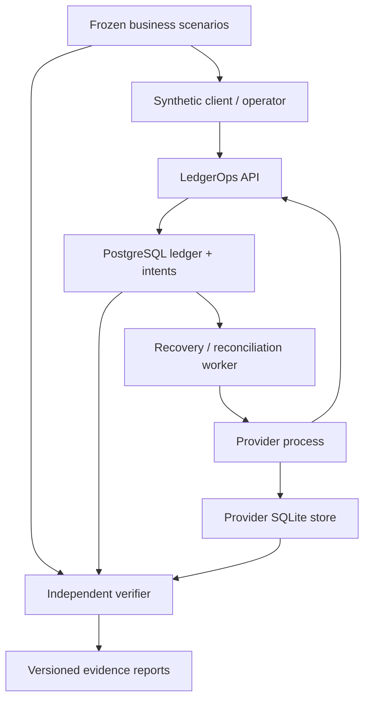

# LedgerOps — implementation blueprint

**Review state:** proposed architecture, 2026-10-23. The project direction is selected; the choices below are recommendations awaiting the user's decisions and Codex's engineering review. No application repository, implementation, passing test, benchmark, deployment, customer or personal-mastery result exists. Source inspection is not execution. Read [CONTRACTS](CONTRACTS.md) for normative proposed behavior and [VERIFICATION](VERIFICATION.md) for ways to disprove it.

## 1. Product and owned engineering contribution

A synthetic marketplace maintains customer and merchant balances. A customer purchases from a merchant by an internal book transfer. A merchant requests a synthetic payout; an independently running provider may execute it while the response is lost. An operator must distinguish execution uncertainty from insufficient funds, inspect mismatches, and make only evidence-supported corrections.

The useful workflow is: submit an instruction → inspect a stable result or unresolved payout → reconcile independent evidence → investigate a discrepancy → propose a version-bound action → have a different identity approve it → append the authorized correction. A read-only view is useful before the operator UI exists.

This is an engineering laboratory and professional-sized subset, not a new bank, a replacement for a mature ledger, validated customer demand, regulatory software, or a trading system. The owned contribution is the explicit business contract, PostgreSQL posting kernel, external-outcome recovery protocol, independent reconciliation, counterexamples, and measured operational behavior. A mature ledger could be preferable in a real product; using one outright here would remove much of the chosen transaction/concurrency implementation exercise. See [L-01–L-08](../01-REFERENCE-REGISTER.md#l-01).

## 2. Recommended topology

The diagram describes ownership, not mandatory deployment containers. The API and worker share the owned Python package, database and transaction functions. The provider has an independent process, store, identifiers, statement generator and code path. The verifier must not reuse the production posting, matching or canonicalization implementation to compute expected financial effects.

| Component | Responsibility | Explicit boundary |
|---|---|---|
| API | Authentication, authorization, typed contracts, bounded requests; own the outer transaction, call one typed admission entry point, commit and return its persisted result | No direct private-table reads/writes; no network call inside the posting transaction |
| PostgreSQL | Authoritative accepted operations, immutable journal, balance/hold projection, request results, intents, observations, reconciliation metadata and decisions | No claim of cross-system atomicity or durability beyond configured storage/backup assumptions |
| Worker | Claim intents, call provider, ingest observations, recover uncertainty; later run reconciliation partitions | At-least-once transport is tolerated; authoritative DB transition decides whether local financial effect is new |
| Provider simulator | Its own durable per-key effects and terminal tombstones; delayed reads/callbacks; independently produced statement rows | Deliberately small synthetic contract, not an imitation of every real provider |
| Verifier | Hand-derived fixtures, independent command fold, journal consistency, reconciliation error classification | Journal export cannot serve as independent truth about what the business intended |
| Operator UI, R5 | Trace evidence, compare run versions, propose/approve scoped actions | Server rechecks permissions and all versions; UI disabling is not authorization |

Use two application stores because external execution survives a local restore. Their separation is necessary to the failure model. Do not introduce a separate service for accounts, balances, transactions, approvals or each worker type.

## 3. Stack recommendation and falsifiable alternatives

**Recommended:** Python 3.13 family; FastAPI/Pydantic; psycopg 3 with explicit transaction blocks and a bounded connection pool; PostgreSQL 18 family; SQL-first Alembic migrations; pytest and Hypothesis; standard-library SQLite for the provider; Docker Compose or native local processes; React/TypeScript only for the later operator workflow. Exact patches, transitive licenses, lockfiles and image digests must be resolved and recorded in the first infrastructure PR against the shared [reference register](../01-REFERENCE-REGISTER.md). No dependency was installed or compatibility-tested in this research.

Use synchronous FastAPI route functions with synchronous psycopg initially, so the framework executes blocking work off its asynchronous event loop. Set finite pool size, pool-acquisition timeout, statement timeout and lock timeout; report these in experiments. One checked-out connection belongs to one transaction at a time. Keep autocommit enabled at the pool connection level and open `with conn.transaction():` explicitly around the unit of work; no accidental transaction opened by an earlier `SELECT`. Transaction contexts are a documented psycopg facility [L-08](../01-REFERENCE-REGISTER.md#l-08); the exact application cancellation behavior remains a required test.

For admission, Python authenticates and validates the request, starts that outer transaction, applies bounded `SET LOCAL` settings and invokes one typed `ledger_api.submit_purchase`, `ledger_api.request_payout` or `ledger_api.reverse_purchase` function. The function performs the complete request claim, operation decision, posting/reservation and response persistence. Python sends the result only after commit acknowledgement. Typed identity-conflict exceptions abort the whole transaction and become HTTP 409 after rollback; a persisted business rejection returns normally and commits its 422 response. Transaction-control commands belong to Python, never to these SQL functions.

| Alternative | Why it is not the first choice | Experiment that could change the choice |
|---|---|---|
| SQLAlchemy ORM unit of work for posting | It adds identity-map/flush behavior to the smallest correctness-critical path. SQLAlchemy Core is reasonable, but direct SQL makes lock and response-persistence boundaries easy to review. | Implement the same 100/80/80 trace and reply-loss trace with SQL capture; adopt Core if it materially simplifies queries without hiding boundaries. |
| SERIALIZABLE for every operation | Strong isolation is valuable but still requires whole-transaction retry and uncertain-commit handling. Sorted row locks make the initial balance serialization point explicit. | Same workload, invariant tests, retry rate, lock time and latency distribution under hot-account skew; select it if broader cross-row predicates make row locking hard to audit. |
| TigerBeetle or Formance as the authoritative ledger | Mature ledger semantics can be reused, but a wrapper would delegate this project's main transaction exercise. Adding one beside PostgreSQL creates a second source of truth. | Optional later compatibility experiment comparing a fixed posting corpus, explicitly separating each product's different retention/error contracts. |
| Celery/Redis or Kafka | PostgreSQL already needs to persist dispatch intent atomically. A transport broker does not remove the outbox or remote uncertainty. | Add only if measured wakeup latency/throughput or independently useful consumers justify it; keep DB/provider identities authoritative. |
| Kubernetes / distributed database kernel | No demonstrated requirement for cluster scheduling or a new consensus implementation. | A future deployment objective must justify the operational burden separately; it is not needed to prove the present contracts. |

## 4. Accounting and consistency choices

Represent a single **synthetic PLN** currency, scale 2. JSON encodes all monetary minor-unit integers as decimal strings; no binary floating point. Posted entries have a positive amount and explicit `D` or `C`. Customer/merchant balances are platform liabilities (credit-normal); the synthetic clearing balance is an asset (debit-normal).

Opening funding is a journal entry, never a balance overwrite. Internal purchase decreases one liability and increases another; it need not appear in a provider statement. A payout hold is an immutable reservation lifecycle plus a derived held amount; it reduces available balance without changing booked money. Success consumes the hold and books the outflow; definitive non-execution releases it. The hold and what we know about the provider are separate dimensions.

All accepted changes to the journal, projections, operation result and necessary intent are committed in one PostgreSQL transaction. The exposed `ledger_api` admission function owns all these private writes and calls a private posting function that enforces complete postings and locks affected accounts in stable order. Deferred constraint checks independently reject incomplete or unbalanced journal groups at commit. Runtime roles cannot directly access private tables or invoke a generic arbitrary-postings function. A Python-side sequence of private INSERT/UPDATE statements is therefore not an equivalent implementation of this design. See the privilege and SQL specification in [CONTRACTS §2–4](CONTRACTS.md#2-schema-and-invariant-enforcement).

## 5. Failure and recovery design

There are three separate questions:

1. Did the local transaction commit? The durable scoped request record and business-operation identity answer this after reconnecting.
2. Did the remote provider execute? A terminal, validated provider observation or a durable non-execution tombstone answers it. A timeout or an eventually consistent `NOT_FOUND` does not.
3. Do independent records agree? Reconciliation answers this against fixed input versions; a balanced journal alone cannot detect a wrong merchant.

The dispatcher commits a `MAY_HAVE_SENT` attempt marker before the network call. Any failure after that point is conservatively uncertain. The provider's proposed `close-if-absent` endpoint makes a durable promise that a key which was absent will never execute; a concurrent submit either wins first and returns its existing state, or loses to the tombstone. This is a **chosen synthetic capability**, not a guarantee supplied by Stripe, Goldman Sachs, or arbitrary payment providers. Without such a capability, an unresolved hold can remain unresolved and require escalation. No local timeout authorizes release.

Callbacks are authenticated and deduplicated, retain original bytes/hashes, and must match business identity, amount, currency, merchant and sequence. Contradictory terminal observations open an incident and stop automated actions for the affected payout; they do not automatically reverse earlier postings. Recovery is idempotent because the consumed/released transition and its journal effect share one transaction.

## 6. Reconciliation is a business join, not a sum check

Maintain three independent evidence categories:

- Business instructions/receipts from frozen test scenarios or a separately retained synthetic client record.
- Internal accepted operations, postings and holds.
- Provider execution records and versioned settlement statements.

Internal purchases use the first two. Payouts use all three, with explicit grouping references and fee rules. Matching is deterministic on identities and contract fields. Equal amounts or nearest timestamps alone never authorize a correction. A batch must remain complete within a partition; arbitrary row-count chunking can split a match group and manufacture exceptions.

Every run binds a ledger export captured from one database snapshot, a command manifest, provider statement versions, a business cutoff, the matching/fee rules, and a code version. Exported records are materialized; a sequence-number high watermark alone is insufficient because sequence allocation is not commit order [L-04](../01-REFERENCE-REGISTER.md#l-04). Publication changes the run from staging to complete only after all required partitions and digests are verified. Later revised statements create new runs.

R4 adds leases only after reassignment is implemented. A generation token is checked **inside the authoritative DB transaction that accepts a partition result**. A stored token without that predicate is decorative. A failed/expired worker may leave unreferenced staged output, but cannot replace an accepted result or publish a completed run.

## 7. Security and operations

Use a local-only fixture identity provider first, with explicit principal, workspace and role memberships. Never make a header asserting `admin` sufficient. A later hosted deployment requires a real identity provider, TLS, secure sessions and secret management; these are deployment choices, not completed features. Workspace isolation is checked in typed API queries and database entry points; cross-workspace IDs return non-disclosing not-found/forbidden behavior. Do not claim database RLS isolation until adversarial cross-tenant tests actually demonstrate it.

Use four separated DB roles: migration owner, no-login function owner, API runtime and worker/report runtime. Runtime roles have USAGE on `ledger_api` and only specifically granted entry-point EXECUTE or reviewed-view SELECT privileges; they have no USAGE, table privileges or function execution in `ledger_private`. Worker mutations use their own narrow entry points under the same rule. Revoke public schema creation and PUBLIC function execution, including default function grants for the owner. Every exposed `VOLATILE SECURITY DEFINER` function fixes a safe search path, qualifies objects, validates scope and has no user-controlled dynamic SQL. A superuser can bypass protections; this is an operational trust boundary, not a cryptographic ledger claim.

Operations expose structured logs keyed by operation, attempt, provider key, reconciliation run and principal. Save no secret or full authentication header. Track queue age, oldest unresolved hold, contradiction count, invalid callback count, DB pool wait, transaction retries, projection drift, partition completion and backup verification. Cardinality-heavy IDs belong in traces/logs, not unbounded metric labels.

Bound request body size, entries per transaction, worker concurrency, callback backlog, in-memory group size and report size. Exhaustion must return a retryable response or quarantine/failed job, never partial financial posting. Start with one recovery worker; batch parallelism is an experiment, not an assumed speedup.

## 8. Migration, backup, restore and deployment

Migrations are reviewed SQL with a clean-database path and an upgrade path from the preceding released schema. Use expand/backfill/validate/contract for populated tables. A destructive migration is never hidden inside application startup. Once new journal semantics are written, rolling back application binaries is not necessarily safe; prefer a forward correction and explicit compatibility test. A database downgrade is not a financial reversal.

Local setup can run one PostgreSQL container, the API, worker and provider with distinct directories. The provider's SQLite file is not inside a ledger database volume. An optional single VM deployment can mirror this topology, but would not establish high availability. No cloud, account, card, GPU or paid API is needed for the core; local hardware/storage needs must be measured. Defaults should run the smallest fixtures without assuming a particular machine; million-row trials are optional workload sizes, not prerequisites for R1.

Backups must include ledger data **and** idempotency/business-operation history, schema version, immutable input/result files and an inventory of their hashes. Restore into a fresh database/deployment location with API writes/dispatch disabled, preserving the same logical workspace and provider namespace and all stable operation identities. A new provider namespace is appropriate only for a destructive fresh scenario, never for recovery of old effects. The provider is deliberately not rolled back. Compare authoritative provider history with restored local records and the independently retained command manifest. Recover known missing local outcomes without issuing new external requests. If request identities, complete provider history or independent instructions are missing, record a restore gap and keep the affected scope frozen. A successful `pg_restore` alone is not application recovery.

## 9. Release outcome and project boundaries

R1 establishes posting, scoped request replay and concurrent-debit behavior. R2 establishes independent journal/business verification and projection rebuild. R3 adds provider uncertainty and recovery. R4 adds versioned reconciliation and measured partition execution. R5 adds operator authorization, version-bound approval, upgrade and restore drills. R6 is a narrow evidence-export/read-only investigation integration, not a second generic agent.

LedgerOps remains independently safe and useful without Chronicle. It may later export immutable synthetic evidence under [the cross-project contract](../02-CROSS-PROJECT-CONTRACT.md); Chronicle receives no write authority or runtime dependency. Both can be implemented in parallel. No software release depends on the user's learning having caught up, though architectural decisions and review capacity remain real constraints.

These projects can demonstrate database and failure reasoning after verification. They do not establish low-latency C++, compiler/runtime implementation expertise, quantitative research, research-level ML, regulated operations or real client delivery.
